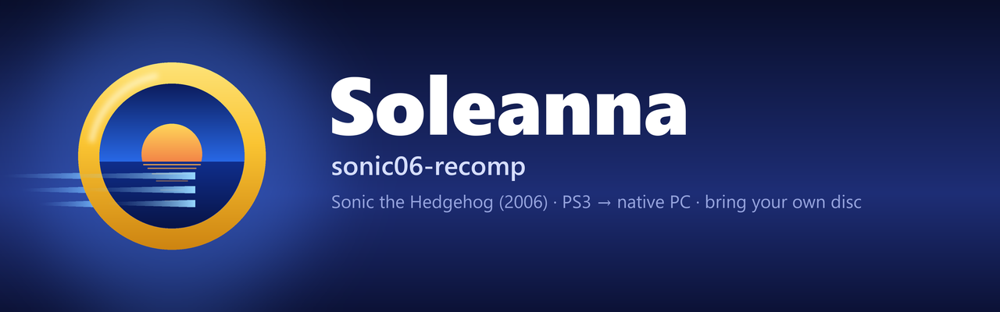
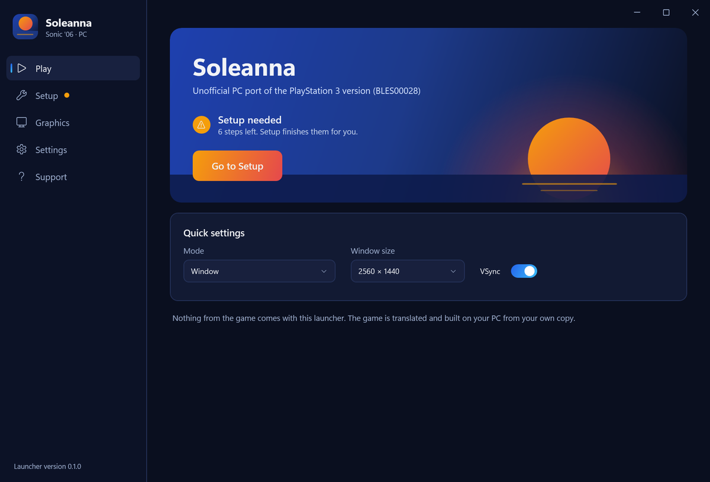
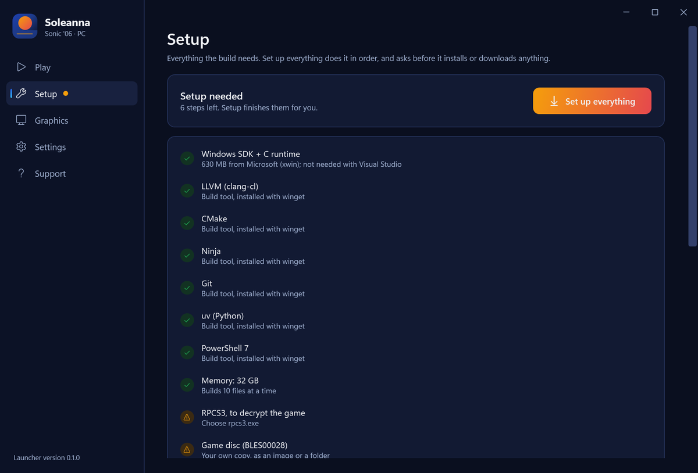
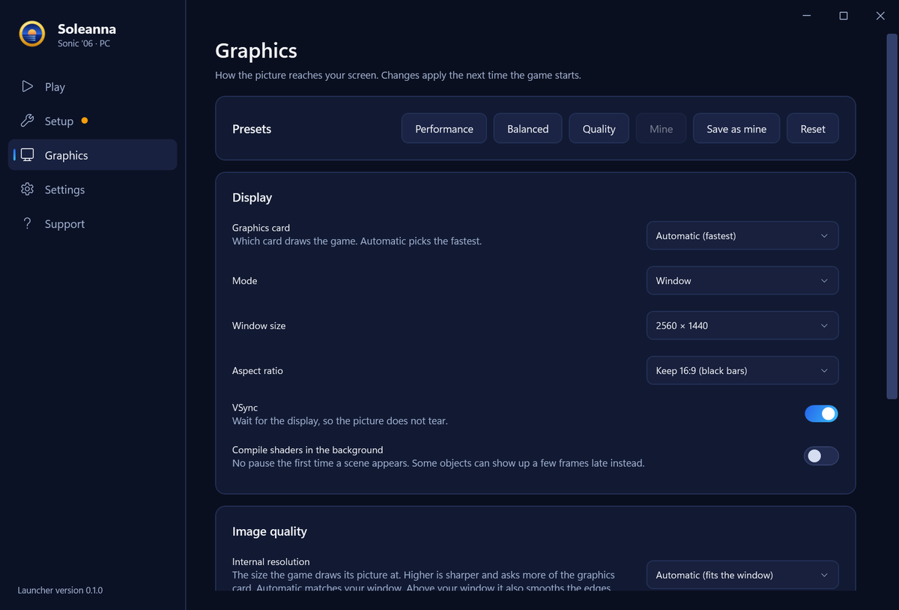
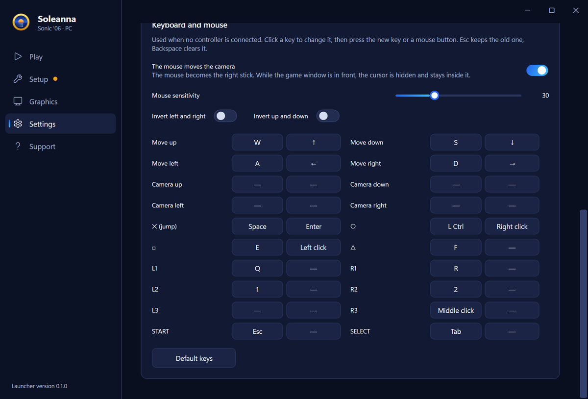
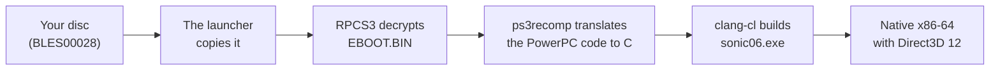

  

  
  
  
  

  <b>Soleanna</b> (sonic06-recomp) is an unofficial PC port of the PlayStation 3 version of <b>Sonic the Hedgehog (2006)</b>, made by static recompilation. 
  No emulator at runtime, and no game files in this repository: the launcher builds the game on your PC from your own disc.

  <a href="https://github.com/DrummingBird1/sonic06-recomp/releases/tag/v0.1.0"><b>Download 0.1.0</b></a> ·
  <a href="#screenshots">Screenshots</a> ·
  <a href="#getting-started">Getting started</a> ·
  <a href="#status">Status</a> ·
  <a href="#how-it-works">How it works</a> ·
  <a href="#reporting-a-problem">Report a problem</a>

> [!IMPORTANT]
> **Version 0.1.0 is an early work in progress.** Every stage and boss starts, but nobody has played a stage to the end yet, and it has been tested on one PC. You need your own copy of the game (BLES00028). This project is not affiliated with or endorsed by SEGA.

## Screenshots

<table>
  <tr>
    <td width="50%"></td>
    <td width="50%"></td>
  </tr>
  <tr>
    <td align="center"><b>Wave Ocean</b>, running on the water</td>
    <td align="center"><b>Crisis City</b>, on a rail</td>
  </tr>
  <tr>
    <td></td>
    <td></td>
  </tr>
  <tr>
    <td align="center"><b>Wave Ocean</b>, a jump over the sea</td>
    <td align="center"><b>Soleanna</b>, the town</td>
  </tr>
</table>

Captured with F12 in this port, on Windows, from the author's own copy, at an internal resolution of 3840×2160 and shown here at 1920×1080. The game and its images belong to SEGA. The pictures are attached to the release, not kept in git.

## Status

| Area | Where it stands |
|---|---|
| ✅ Menus and story | The title screen, menus and movies, and the story up to Soleanna's town, with music and voices |
| ✅ Stages and bosses | All 83 stage entries and 18 bosses start without a crash, in tests of about a minute each |
| ⚠️ Playthrough | No stage has been played to the end by a person yet |
| ✅ Speed | The story scenes hold the game's own 30 fps cap; Wave Ocean runs at 57–59 fps |
| ⚠️ Controllers | Supported through SDL2, but not yet tried with a real controller |
| ⚠️ Hardware | Tested on one Windows PC |

What is in each version is in [CHANGELOG.md](CHANGELOG.md).

## The launcher

The project and its launcher are named **Soleanna**, after the game's city; `sonic06-recomp` is the repository's name. The launcher copies your disc, decrypts it with your RPCS3, installs the build tools, downloads FFmpeg, SDL2 and ps3recomp, builds the game, and starts it. It ships no artwork of the game: once your disc is copied, it shows the pictures from the disc itself.

<table>
  <tr>
    <td width="50%"></td>
    <td width="50%"></td>
  </tr>
  <tr>
    <td align="center"><b>Play</b>: one button once setup is done</td>
    <td align="center"><b>Setup</b>: everything the build needs, in order</td>
  </tr>
  <tr>
    <td></td>
    <td></td>
  </tr>
  <tr>
    <td align="center"><b>Graphics</b>: presets, resolution, filters and colour</td>
    <td align="center"><b>Keyboard and mouse</b>: two keys for every control</td>
  </tr>
</table>

It speaks English, Hebrew, Spanish, French, German, Italian, Portuguese (Brazil), Japanese, Russian and Arabic, and starts in your Windows language. The translations have not been checked by native speakers yet: corrections to `launcher/Strings/*.json` are welcome.

## Getting started

**You need**

- Windows 10 or 11, 64-bit, with 8 GB of RAM or more, and about 10 GB of free disk space
- [RPCS3](https://rpcs3.net), to decrypt the game's `EBOOT.BIN` on your machine
- Your own BLES00028 disc, as an ISO or a folder

**Then**

1. Download `sonic06-recomp-0.1.0-dcdfda8.zip` from the [release](https://github.com/DrummingBird1/sonic06-recomp/releases/tag/v0.1.0), unzip it, and run `Launcher.exe`. In a git checkout, run `Sonic06.cmd`, which builds the launcher first (it needs the .NET SDK).
2. Open **Setup** and press **Set up everything**. It lists what it will do and asks before it installs or downloads anything. Then it:
   - installs the missing build tools: LLVM, CMake, Ninja, Git, uv and PowerShell 7 with winget, and Microsoft's C runtime and Windows SDK (about 630 MB, with [xwin](https://github.com/Jake-Shadle/xwin)) once you accept Microsoft's license. Visual Studio is not needed; if you have it with the C++ tools, the build uses it.
   - copies your disc into `game/` and decrypts it with your RPCS3,
   - downloads FFmpeg 8 (LGPL) for the movies, SDL2 2.32.10 (zlib) for controllers, and ps3recomp,
   - translates the game code and builds it. This is the long part: about 17 minutes on a fast PC with 32 GB, longer on a slower one or with less memory.
3. Press **Play**.

From a console, `tools/launcher.ps1` has the same steps without the window.

How long the build takes, and how much memory it uses

The launcher builds as many files at a time as the memory allows: one with 8 GB, four with 16 GB, ten with 32 GB. On the 20-thread PC it was made on, ten at a time took 14 minutes, and two at a time took 23 minutes with a peak of 5 GB. A PC with less memory has not been tried yet.

## Controls

Controllers work through SDL2: Xbox, DualShock 4, DualSense and Switch Pro. Without SDL2 the game falls back to XInput, which sees Xbox-style controllers only. Without a controller, the keyboard and mouse are the pad:

| Action | Keys |
|---|---|
| Move | <kbd>W</kbd> <kbd>A</kbd> <kbd>S</kbd> <kbd>D</kbd> or the arrows |
| Jump, confirm (✕) | <kbd>Space</kbd>, <kbd>Enter</kbd> |
| Back (○) | <kbd>Left Ctrl</kbd>, right mouse button |
| □ / △ | <kbd>E</kbd> or left mouse button / <kbd>F</kbd> |
| L1 / R1 · L2 / R2 · R3 | <kbd>Q</kbd> / <kbd>R</kbd> · <kbd>1</kbd> / <kbd>2</kbd> · middle mouse button |
| Pause (START) · SELECT | <kbd>Esc</kbd> · <kbd>Tab</kbd> |
| Camera | the mouse |

Every control takes up to two keys or mouse buttons on the **Settings** page, which also has the mouse sensitivity, a switch to invert either camera axis, and the stick dead zone.

## Graphics

- Window or borderless fullscreen, window size, aspect ratio (keep 16:9 or stretch) and VSync
- **Internal resolution**: the size the game draws at, from 1280×720 as on the PS3 up to 3840×2160, or automatic, which matches your window. Set above your window, it is supersampling: every pixel is the average of everything drawn under it, which smooths the edges.
- Upscaling filter (smooth, sharp pixels, bicubic, nearest), sharpening, FXAA and texture filtering
- Brightness, saturation and contrast
- Performance, balanced and quality presets, and one of your own
- Shaders are kept on disk after their first use. The first time a scene appears there can be a short pause while its shaders compile; "Compile shaders in the background" removes it, and some objects can then appear a few frames late.
- <kbd>F12</kbd> saves a screenshot in `Pictures\Sonic06`.

**Measured**

| | RTX 4070 SUPER | Intel UHD 770 |
|---|---|---|
| First story scene | 30 fps, the game's cap | 30 fps |
| Wave Ocean, one player | 57–59 fps | not measured |
| Wave Ocean, split-screen | 59.5–59.8 fps | about 47 fps |
| 3840×2160 internal resolution | as fast as 1280×720 | not measured |

Weaker graphics cards and AMD cards have not been tried.

## How it works

The game's PowerPC code is translated ahead of time into C and compiled for x86-64. The PS3's system libraries are reimplemented at a high level, its SPU programs run on host threads, and the RSX graphics commands go through a Direct3D 12 renderer. The port builds on [ps3recomp](https://github.com/sp00nznet/ps3recomp), with 47 changes of its own kept as patches in [`patches/ps3recomp`](patches/ps3recomp). Everything made from the game stays in `game/`, `work/` and `build/` on your PC, and git ignores them.

## Reporting a problem

On the **Support** page, **Create a bug report** saves a zip on your desktop: your PC's specs, the setup status and the last game logs. It has no game files, and your Windows user folder is replaced by `%USERPROFILE%`. The launcher then opens a [new issue](https://github.com/DrummingBird1/sonic06-recomp/issues/new?template=bug.md): attach the zip, with what you did and what you saw.

## Contributing

Start with [docs/HANDOFF.md](docs/HANDOFF.md), in Hebrew: the state of the project, the test recipes and the next steps. [docs/PHASE1.md](docs/PHASE1.md) is the history of every fix, with its measurements. The launcher's source is in `launcher/` (C#, .NET Framework 4.8: `dotnet build launcher -c Release`).

Keep game files, and anything derived from them, out of git: the ISO, `game/`, `work/` and the built executable.

## Credits

- [ps3recomp](https://github.com/sp00nznet/ps3recomp) by sp00nznet, the toolkit this port is built on (MIT)
- [RPCS3](https://rpcs3.net), which decrypts your disc
- [FFmpeg](https://ffmpeg.org) for the movies, [SDL2](https://libsdl.org) for controllers, [xwin](https://github.com/Jake-Shadle/xwin) for Microsoft's C runtime and SDK, and [LLVM](https://llvm.org) for the compiler

## License

The code in this repository is under the [MIT license](LICENSE). It does not cover the game, which belongs to SEGA, or the tools the launcher downloads, which have their own licenses. Sonic the Hedgehog is a trademark of SEGA, and this project is not affiliated with or endorsed by SEGA.
